<p align="center"></p>

<p align="center">
<a href="https://thebharath.co"></a>
<a href="https://linkedin.com/in/thebharathkumar"></a>
<a href="mailto:bharath.kr702@gmail.com"></a>
<a href="https://medium.com/@thebharathkumar"></a>
</p>

<a href="./scripts/status_page.py">

</a>

<p align="center"><sub>☝️ This board is not a screenshot. A <a href="./.github/workflows/status.yml">GitHub Action</a> rebuilds it every day from the GitHub API. An observability engineer's profile should be observable.</sub></p>

## 🔭 Right now

- **Working:** AI Engineer at Rolai, New York City, since November 2026
- **Building in the open:** the agent reliability stack below: evals, observability, and release gates for LLM agents
- **Ask me about:** MCP observability, agent eval design, and catching silent regressions before users do
- **Background:** M.S. Computer Science, Pace University. Before Rolai I built and operated Pace's multi-agent platform, the production work behind the receipts below

## ✅ The receipts

<p align="center">
<a href="./CLAIMS.md"></a>
</p>

<p align="center"><sub>Each line maps to its evidence in <a href="./CLAIMS.md">CLAIMS.md</a>, including which claims come from private production work.</sub></p>

## 🔦 Start here

<table>
<tr>
<td width="50%" valign="top">

### [agent-triage](https://github.com/thebharathkumar/agent-triage)
Ranks multi-agent failures by severity, frequency, and recovery from OpenTelemetry or NDJSON traces.

`pip install agent-triage`

**On PyPI · 220+ tests · 93%+ coverage**

</td>
<td width="50%" valign="top">

### [mcp-otel-audit](https://github.com/thebharathkumar/mcp-otel-audit)
A reproducible audit of 4 MCP OpenTelemetry libraries, **scored against the official OTel spec with Weaver**.

**A maintainer of Logfire and the MCP Python SDK responded publicly.**

</td>
</tr>
<tr>
<td width="50%" valign="top">

### [shipcheck](https://github.com/thebharathkumar/shipcheck)
Release gate for agent changes. Runs the current agent and a proposed change on the same cases and returns SHIP, REVIEW or BLOCK, with cost next to accuracy.

`shipcheck demo`

**179 tests · standard library only · offline demo in under 2 seconds**

</td>
<td width="50%" valign="top">

### [ForgeSync](https://github.com/thebharathkumar/ForgeSync)
Financial reconciliation infra with explainable matching and human-approved write-back.

**125 unit + 75 integration tests on real Postgres and Redis. Scoring runs ~25x faster than ingestion.**

</td>
</tr>
<tr>
<td width="50%" valign="top">

### [project-transfer](https://github.com/thebharathkumar/project-transfer)
Pace University's course equivalency system as a modern web app: students search about 3,000 pre-approved foreign course transfers instead of emailing the registrar.

**Next.js 15 · TypeScript · Entra ID SSO · async Excel import pipeline · about 240 tests**

</td>
<td width="50%" valign="top">

### [jober](https://github.com/thebharathkumar/jober)
Bus Factor: organizational memory that survives turnover. A departing expert's knowledge, captured and answered with citations, calibrated confidence, and abstention when the record is thin.

**RAG · calibration measured against ground truth (ECE) · abstains instead of guessing**

</td>
</tr>
</table>

<p align="center"></p>

<p align="center"><sub>shipcheck, running for real. It ships with the repo: <code>shipcheck demo</code>, offline, standard library only.</sub></p>

## 🧪 House rules

1. **Every number comes from a file the code wrote.** [ForgeSync](https://github.com/thebharathkumar/ForgeSync) commits the report behind every benchmark.
2. **Thresholds are fixed before the results.** [downgrade](https://github.com/thebharathkumar/downgrade) refuses to load runs whose settings were edited afterwards.
3. **Weak results are published as weak.** [loopcheck](https://github.com/thebharathkumar/loopcheck) reports recall 0.33. [gcf-virome](https://github.com/thebharathkumar/gcf-virome) reports a null result as null.
4. **Demos run offline in seconds, no API key.** `shipcheck demo` · `loopcheck demo` · `claimtrace demo` · `python3 -m estimate_check demo`
5. **Say what I don't know.** [estimate-check](https://github.com/thebharathkumar/estimate-check) has a section called "What I do not know". [shipcheck](https://github.com/thebharathkumar/shipcheck) has "Honest limits".

```mermaid
flowchart LR
subgraph B["① Build"]
LC["loopcheck<br/>verifier-first agent loop"]
CT["claimtrace<br/>every claim traced to a char span"]
OD["obindoc<br/>cited, verified RAG"]
end
subgraph R["② Route"]
CF["costfloor<br/>cheapest model, no regression"]
DG["downgrade<br/>catches router quality loss"]
end
subgraph O["③ Observe"]
AT["agent-triage<br/>ranks failures from traces"]
FR["agent-flight-recorder<br/>audit + tracing skills"]
SM["super-mcp-eval<br/>evals for MCP servers"]
MO["mcp-otel-audit<br/>OTel semconv audit"]
end
subgraph F["④ Fix and gate"]
RX["agent-rx<br/>proposes and A/B-tests fixes"]
SC["shipcheck<br/>ship / review / block gate"]
end
B --> R --> O --> F
F -. lessons .-> B

classDef build fill:#0d1b2e,stroke:#58A6FF,color:#e6edf3
classDef route fill:#1c1917,stroke:#F59E0B,color:#e6edf3
classDef observe fill:#052e2b,stroke:#10B981,color:#e6edf3
classDef fix fill:#3b0a24,stroke:#EC4899,color:#e6edf3
class LC,CT,OD build
class CF,DG route
class AT,FR,SM,MO observe
class RX,SC fix
```

<details>
<summary><b>🧭 The full reliability stack</b> (how the repos fit together)</summary>
<br/>



| Project | What it does | Proof |
|---|---|---|
| [**loopcheck**](https://github.com/thebharathkumar/loopcheck) | Should you trust that the agent actually finished? Mutation-tested verification, calibrated confidence, HMAC-chained audit log. | 86 tests · precision 1.00 / recall 0.33 on a 15-file seed set |
| [**claimtrace**](https://github.com/thebharathkumar/Claimtrace) | Five-node LangGraph pipeline. Every claim points to an exact source chunk and character span, and contradicting sources get flagged. | Byte-flip tamper test on the audit chain |
| [**downgrade**](https://github.com/thebharathkumar/downgrade) | Measures silent quality loss when a model router downgrades a request. | Stats layer built (SPRT, Benjamini-Hochberg, Kupiec and Christoffersen backtests). No sweep results published yet |
| [**costfloor**](https://github.com/thebharathkumar/costfloor) | Finds the cheapest model that does not silently break your agent. | 47 tests · CI on Python 3.11 and 3.12 |
| [**agent-flight-recorder**](https://github.com/thebharathkumar/agent-flight-recorder) | Claude Code plugin: hash-chained audit logs, OTel tracing, eval scaffolds, trace triage. | 90% coverage gate in CI |
| [**agent-rx**](https://github.com/thebharathkumar/agent-rx) | Diagnoses agent failures, proposes fixes, A/B-tests them. | Python · MIT |
| [**shipcheck**](https://github.com/thebharathkumar/shipcheck) | Release gate: blocks any change that adds a new safety failure, even when the average score goes up. | 179 tests · Wilson 95% CIs · exact McNemar |
| [**super-mcp-eval**](https://github.com/thebharathkumar/super-mcp-eval) | Eval harness for MCP servers: schema compliance, tool-selection accuracy. | Wilson 95% CIs |
| [**obindoc**](https://github.com/thebharathkumar/obindoc) | Grounded RAG with span-level citations and a verifier loop. | Under 900 lines · 29 tests |

</details>

<details>
<summary><b>🔬 Same rigor, other domains</b> (bioinformatics, insurance, vision, wearables)</summary>
<br/>

| Project | What makes it worth a look |
|---|---|
| [**gcf-virome**](https://github.com/thebharathkumar/gcf-virome) | One-command Snakemake pipeline on public periodontal metagenomes. Reports its null result as null, then runs its own host-depletion follow-up. 40 tests on a REDCap / NCBI metadata validator. |
| [**estimate-check**](https://github.com/thebharathkumar/estimate-check) | Deterministic verifier for restoration estimates. Six detectors, zero runtime dependencies. Its optional LLM judge can annotate findings but never change them. |
| [**vehicle-damage-detection**](https://github.com/thebharathkumar/vehicle-damage-detection) | YOLO11s-seg on CarDD: 0.753 mask mAP50 held out, with ablation, error analysis, and a robustness suite. |
| [**streamsense**](https://github.com/thebharathkumar/streamsense) | CNN + transformer activity recognition on PAMAP2, ONNX export, int8 quantization. |

</details>

## 📚 Research publications

<table>
<tr>
<td width="50%" valign="top">

#### A Deep CNN Approach for Identifying Medicinal and Edible Plants in the Western Ghats
<a href="https://www.atlantis-press.com/proceedings/icacecs-23/125995742"></a>

Deep CNN that identifies medicinal and edible plant species from the Western Ghats, at **89% accuracy**. *Corresponding author.*

</td>
<td width="50%" valign="top">

#### Driver Drowsiness Detection using AI
<a href="https://www.ijaresm.com/sahasransu-mohanty"></a>

Real-time fatigue detection from facial landmarks and eye aspect ratio, using Dlib plus a Keras CNN, shipped as an Android app. *Co-author.*

</td>
</tr>
</table>

## 📜 Certifications

Anthropic: Building with Claude on Amazon Bedrock (2026) · AWS Solutions Architect Associate (2026) · Red Hat Certified System Administrator (2022)

## 🔁 Open source

- [**faramesh/faramesh-core**](https://github.com/faramesh/faramesh-core) (Go, AI agent governance): merged [#33](https://github.com/faramesh/faramesh-core/pull/33), which wires delegation tokens into runtime policy evaluation. Also proposed the daemon API for agent-to-agent delegation ([#24](https://github.com/faramesh/faramesh-core/pull/24)) and a SQLite-backed scheduled-execution store ([#34](https://github.com/faramesh/faramesh-core/pull/34)).

## 🛠️ Tech stack

<p></p>

<details>
<summary><b>Full table</b></summary>

| Area | Tools |
|---|---|
| **AI / LLM** | Claude, Amazon Bedrock, OpenAI, LangGraph, LangChain, MCP, OpenTelemetry (GenAI semconv), RAG, LLM evals, Hugging Face |
| **ML** | PyTorch, TensorFlow, Keras, scikit-learn, OpenCV, YOLO, ONNX |
| **Backend** | FastAPI, Fastify, Node.js, Go, Prisma, Zod, BullMQ |
| **Data** | PostgreSQL, Redis, Kafka (Redpanda), DuckDB, ChromaDB, SQLite |
| **Cloud / Infra** | AWS (incl. CDK), Azure, Docker, Kubernetes, Linux |
| **Testing** | pytest, Vitest, Playwright, mutation testing |
| **Science** | Snakemake, R (vegan), bowtie2, samtools |

</details>

<details>
<summary><b>🤖 For agents and tools</b> (generated from scripts/facts.json, the same facts as CLAIMS.md)</summary>

```json
{
  "name": "Bharath Kumar Rajesh",
  "role": "AI Engineer",
  "employer": "Rolai",
  "location": "New York City",
  "focus": ["LLM agent evals", "MCP observability", "release gates", "agent reliability"],
  "top_repos": ["agent-triage", "mcp-otel-audit", "shipcheck", "ForgeSync", "project-transfer", "jober"],
  "claims_file": "https://github.com/thebharathkumar/thebharathkumar/blob/main/CLAIMS.md",
  "contact": "bharath.kr702@gmail.com"
}
```

</details>

## 🤝 Let's connect

<p align="center"><sub><a href="https://thebharath.co">thebharath.co</a> · <a href="https://linkedin.com/in/thebharathkumar">LinkedIn</a> · <a href="mailto:bharath.kr702@gmail.com">bharath.kr702@gmail.com</a> · <a href="https://medium.com/@thebharathkumar">Medium</a></sub></p>

<p align="center"><sub>Writing: <a href="https://github.com/thebharathkumar/mcp-otel-audit/blob/main/docs/blog/auditing-mcp-otel.md">Auditing MCP OpenTelemetry instrumentations</a> · Off the clock: NYC EDM, house, techno, melodic, bass</sub></p>

<p align="center"></p>
