  

☝️ This board is not a screenshot. A <a href="./.github/workflows/status.yml">GitHub Action</a> rebuilds it every day from the GitHub API. An observability engineer's profile should be observable.

<table>
<tr>
<td width="62%" valign="top">

**Looking for:** AI Engineer · Applied AI Engineer · Forward Deployed Engineer 
**Based in:** New York City, open to relocation · F-1 OPT 
**Education:** M.S. Computer Science, Pace University, GPA 3.87 
**Reach me:** [bharath.kr702@gmail.com](mailto:bharath.kr702@gmail.com) · [thebharath.co](https://thebharath.co) · [LinkedIn](https://linkedin.com/in/thebharathkumar)

</td>
<td width="38%" valign="top">

**Shipped in production** 
Multi-agent platform, LangGraph + Claude on Bedrock 
**10K+** daily users · **99.5%** uptime 
**0.92** MRR@5 over **50K+** docs 
**4** silent regressions caught before users

</td>
</tr>
</table>

## ✅ The receipts

  

## 🔦 Start here

<table>
<tr>
<td width="33%" valign="top">

### [agent-triage](https://github.com/thebharathkumar/agent-triage)
Ranks multi-agent failures by severity, frequency, and recovery from OpenTelemetry or NDJSON traces.

`pip install agent-triage`

**On PyPI · 220+ tests · 93%+ coverage**

</td>
<td width="33%" valign="top">

### [mcp-otel-audit](https://github.com/thebharathkumar/mcp-otel-audit)
A reproducible audit of 4 MCP OpenTelemetry libraries. **None of them ship the spec's MCP histograms.**

**A maintainer of Logfire and the MCP Python SDK responded publicly.**

</td>
<td width="33%" valign="top">

### [ForgeSync](https://github.com/thebharathkumar/ForgeSync)
Financial reconciliation infra with explainable matching and human-approved write-back.

**125 unit + 75 integration tests on real Postgres and Redis. Scoring runs ~25x faster than ingestion.**

</td>
</tr>
</table>

## 🧪 House rules

1. **Every number comes from a file the code wrote.** [ForgeSync](https://github.com/thebharathkumar/ForgeSync) commits the report behind every benchmark.
2. **Thresholds are fixed before the results.** [downgrade](https://github.com/thebharathkumar/downgrade) refuses to load runs whose settings were edited afterwards.
3. **Weak results are published as weak.** [loopcheck](https://github.com/thebharathkumar/loopcheck) reports recall 0.33. [gcf-virome](https://github.com/thebharathkumar/gcf-virome) reports a null result as null.
4. **Demos run offline in seconds, no API key.** `loopcheck demo` · `claimtrace demo` · `python3 -m estimate_check demo`
5. **Say what I don't know.** [estimate-check](https://github.com/thebharathkumar/estimate-check) has a section called "What I do not know".

```mermaid
flowchart LR
    subgraph B["① Build"]
        LC["loopcheck<br/>verifier-first agent loop"]
        CT["claimtrace<br/>every claim traced to a char span"]
        OD["obindoc<br/>cited, verified RAG"]
    end
    subgraph R["② Route"]
        CF["costfloor<br/>cheapest model, no regression"]
        DG["downgrade<br/>catches router quality loss"]
    end
    subgraph O["③ Observe"]
        AT["agent-triage<br/>ranks failures from traces"]
        FR["agent-flight-recorder<br/>audit + tracing skills"]
        SM["super-mcp-eval<br/>evals for MCP servers"]
        MO["mcp-otel-audit<br/>OTel semconv audit"]
    end
    subgraph F["④ Fix"]
        RX["agent-rx<br/>proposes and A/B-tests fixes"]
    end
    B --> R --> O --> F
    F -. lessons .-> B

    classDef build fill:#1e1b4b,stroke:#7C6CF2,color:#e6edf3
    classDef route fill:#1c1917,stroke:#F59E0B,color:#e6edf3
    classDef observe fill:#052e2b,stroke:#10B981,color:#e6edf3
    classDef fix fill:#3b0a24,stroke:#EC4899,color:#e6edf3
    class LC,CT,OD build
    class CF,DG route
    class AT,FR,SM,MO observe
    class RX fix
```

<b>🧭 The full reliability stack</b> (how the repos fit together)

 

| Project | What it does | Proof |
|---|---|---|
| [**loopcheck**](https://github.com/thebharathkumar/loopcheck) | Should you trust that the agent actually finished? Mutation-tested verification, calibrated confidence, HMAC-chained audit log. | 86 tests · precision 1.00 / recall 0.33 on a 15-file seed set |
| [**claimtrace**](https://github.com/thebharathkumar/Claimtrace) | Five-node LangGraph pipeline. Every claim points to an exact source chunk and character span, and contradicting sources get flagged. | Byte-flip tamper test on the audit chain |
| [**downgrade**](https://github.com/thebharathkumar/downgrade) | Measures silent quality loss when a model router downgrades a request. | Sequential tests, SPRT, Benjamini-Hochberg, Kupiec and Christoffersen backtests |
| [**costfloor**](https://github.com/thebharathkumar/costfloor) | Finds the cheapest model that does not silently break your agent. | 47 tests · CI on Python 3.11 and 3.12 |
| [**agent-flight-recorder**](https://github.com/thebharathkumar/agent-flight-recorder) | Claude Code plugin: hash-chained audit logs, OTel tracing, eval scaffolds, trace triage. | 90% coverage gate in CI |
| [**agent-rx**](https://github.com/thebharathkumar/agent-rx) | Diagnoses agent failures, proposes fixes, A/B-tests them. | Python · MIT |
| [**super-mcp-eval**](https://github.com/thebharathkumar/super-mcp-eval) | Eval harness for MCP servers: schema compliance, tool-selection accuracy. | Wilson 95% CIs |
| [**obindoc**](https://github.com/thebharathkumar/obindoc) | Grounded RAG with span-level citations and a verifier loop. | Under 900 lines · 29 tests |

<b>🔬 Same rigor, other domains</b> (bioinformatics, insurance, vision, wearables)

 

| Project | What makes it worth a look |
|---|---|
| [**gcf-virome**](https://github.com/thebharathkumar/gcf-virome) | One-command Snakemake pipeline on public periodontal metagenomes. Reports its null result as null, then runs its own host-depletion follow-up. 40 tests on a REDCap / NCBI metadata validator. |
| [**estimate-check**](https://github.com/thebharathkumar/estimate-check) | Deterministic verifier for restoration estimates. Six detectors, zero runtime dependencies. Its optional LLM judge can annotate findings but never change them. |
| [**vehicle-damage-detection**](https://github.com/thebharathkumar/vehicle-damage-detection) | YOLO11s-seg on CarDD: 0.753 mask mAP50 held out, with ablation, error analysis, and a robustness suite. |
| [**streamsense**](https://github.com/thebharathkumar/streamsense) | CNN + transformer activity recognition on PAMAP2, ONNX export, int8 quantization. |

## 📚 Research publications

<table>
<tr>
<td width="50%" valign="top">

#### A Deep CNN Approach for Identifying Medicinal and Edible Plants in the Western Ghats

Deep CNN that identifies medicinal and edible plant species from the Western Ghats, at **89% accuracy**. *Corresponding author.*

</td>
<td width="50%" valign="top">

#### Driver Drowsiness Detection using AI

Real-time fatigue detection from facial landmarks and eye aspect ratio, using Dlib plus a Keras CNN, shipped as an Android app.

</td>
</tr>
</table>

## 📜 Certifications

  
  
  

## 🔁 Open source

- [**faramesh/faramesh-core**](https://github.com/faramesh/faramesh-core) (Go, AI agent governance): authored 9 PRs. Merged [#33](https://github.com/faramesh/faramesh-core/pull/33), which wires delegation tokens into runtime policy evaluation.
- [**agent-triage**](https://pypi.org/project/agent-triage/): my own package, published on PyPI.

## 🛠️ Tech stack

  

| Area | Tools |
|---|---|
| **AI / LLM** | Claude, Amazon Bedrock, OpenAI, LangGraph, LangChain, MCP, OpenTelemetry (GenAI semconv), RAG, LLM evals, Hugging Face |
| **ML** | PyTorch, TensorFlow, Keras, scikit-learn, OpenCV, YOLO, ONNX |
| **Backend** | FastAPI, Fastify, Node.js, Prisma, Zod, BullMQ |
| **Data** | PostgreSQL, Redis, MongoDB, Elasticsearch, Kafka, DuckDB |
| **Cloud / Infra** | AWS (incl. CDK), Azure, GCP, Docker, Kubernetes, Terraform, Linux |
| **Testing** | pytest, Vitest, Playwright, mutation testing |
| **Science** | Snakemake, R (vegan), bowtie2, samtools |

## 🤝 Let's connect

  
  
  
  
  
  
  

Writing: <a href="https://github.com/thebharathkumar/mcp-otel-audit/blob/main/docs/blog/auditing-mcp-otel.md">Auditing MCP OpenTelemetry instrumentations</a> · more on <a href="https://medium.com/@thebharathkumar">Medium</a> Fun fact: I can solve a Rubik's cube in under 2 minutes.

